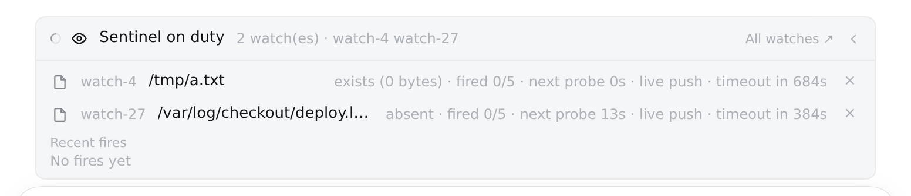
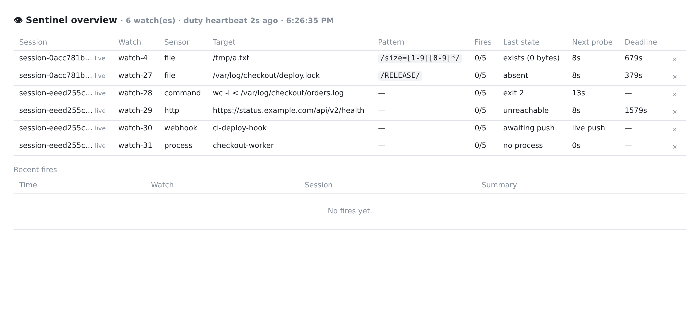
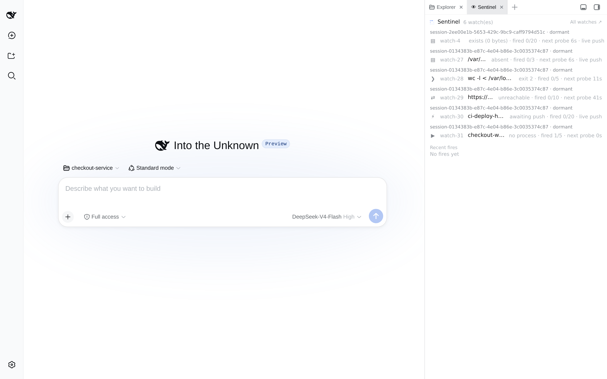

# dsh-sentinel

English | [中文](README.zh.md)

Condition-driven wakeup for [DeepSeek Harness](https://github.com/deepseek-ai/deepseek-harness): the agent registers a watch, goes to sleep — even closes the session — and the sentinel wakes it when the condition happens. Every subscription and every fire is a user-visible session event, and the browser dock shows what is on duty.



## How it works

The node half owns one server-lifetime runtime that folds a plugin-owned sidecar log (`$DSH_HOME/sentinel.jsonl`) into live subscriptions, probes every probe sensor on a shared 5s heartbeat, observes every published session's durable `turn/end` event for `session` watches, and delivers wakeups through the official followup channel — resuming a dormant session's agent first when needed. Subscriptions therefore survive process restarts, and conditions that become true while the server is down late-fire on the next probe (session watches fire on the next observed turn end). A watch can also carry a planned deadline (`timeout_seconds`): if it never fires before that deadline, the sentinel wakes the agent with a timeout notice and retires the watch — see [Planned timeouts](#planned-timeouts).

Watching is a resident-process concern: probing and fire delivery only run while a long-running dsh process (typically `dsh web`) is up. Headless one-shot runs load the plugin and can create, list and cancel watches, but nothing probes after the process exits — those watches become active once a resident process starts.

One duty owner per `$DSH_HOME`: a lease file (`sentinel.lease`) makes the first process own probing and delivery; a second dsh process on the same home stays passive (tools work, writes persist to the shared sidecar) and takes over within one lease TTL of the owner dying. The owner re-reads the sidecar every heartbeat, so watches created on a passive instance are adopted automatically. Delivery is at-least-once: a fire logged but not delivered before a crash is requeued on the next boot from its `delivered` watermark.

The browser half is a dock card above the composer (the `conversation.input.dock` family) listing the session's active watches — sensor, target, live probe state, fire budget, next-probe countdown — plus recent fire history when expanded. It polls the read-only state route and renders nothing when the session has no watches.

Two surfaces make the server-global watch set visible. A **Sentinel entry in the sidebar's global panel list** (`sidebar.panellist`, id `sentinel`) opens the watch table in the central column (`main`, the same id) — its glyph carries a state dot while any watch is active. The dashboard is a standalone table of every watch across every session: session (active/dormant), sensor, target, pattern, fire budget, last probe state, next probe.



## Sensors

| Kind | Engine | Fires on |
| --- | --- | --- |
| `file` | path snapshot + inotify push | snapshot change (sub-second); accelerated by fs events |
| `command` | read-only shell line, probed on an interval | output/exit-code change |
| `http` | URL probed on an interval | status/body change |
| `process` | `pgrep -f` pattern, probed on an interval | match-set change |
| `port` | TCP connect to `[host:]port`, probed on an interval | reachability change (open/closed/timeout) |
| `webhook` | pure push | any POST to the returned hook URL |
| `session` | host session-event feed (no probing) | another session's `turn/end`; optional `pattern` filters the reason kind |

With `pattern`, probe kinds fire on the no-match→match edge of that regex, webhooks accept only matching payloads, and session watches fire only when the ended turn's reason kind matches the regex (`completed`, `max-tokens`, `aborted`, `blocked`, `error`, `interrupted`, `forked`); without it, probe kinds fire on any change after the baseline, webhooks fire on any POST, and session watches fire on any turn end.

Session watches make serial session chains possible without poking anything from a prompt: `{ "kind": "session", "target": "<other-session-id>", "note": "step 1 finished — you're up", "maxFires": 1 }` wakes the watching session when the target session finishes a turn, and `pattern: "^completed$"` requires a clean completion (a crashed or aborted session never satisfies it, so the chain stops). The event is the host's durable `turn/end`; no probe baseline or heartbeat is involved. A turn end that happens while no resident dsh process can observe events is not replayed later — use a probe-backed gate when a chain must survive total downtime.

## Planned timeouts

`timeout_seconds` adds a planned deadline to any watch. If no condition fire arrives before it, the sentinel delivers one **TIMEOUT wakeup** — the original note, the planned deadline, and the last probe state/snapshot — so the agent can check whether the watched task is stuck or the watch itself was misconfigured (wrong target, pattern that can never match, missing process), then retire it. That is the difference from `expires_in_seconds`, which stays a silent lifetime cap: expiry just cancels the watch, while a timeout wakes the agent.

```json
{ "kind": "command", "target": "npm run build", "note": "构建结束后继续部署", "maxFires": 1, "timeout_seconds": 600 }
```

A timeout is exactly what a stuck or misconfigured watch needs: a "5-minute" task can no longer drag on for 30 minutes unnoticed.

- The deadline is scanned on the shared heartbeat, so it survives restarts and late-fires on boot if it passed while no resident process was up (like a probe transition). Granularity is one heartbeat.
- It is terminal and at most once: the fired timeout retires the watch, even when the budget still has fires left.
- A watch that already fired is retired silently at its deadline — the deadline guards the never-fired case; register a second watch if you want a scheduled review ping.
- Session and webhook watches are included: no probing is involved, and their last state (`awaiting turn end` / `awaiting push`) is reported with the timeout.
- Keep `timeout_seconds` longer than `interval_seconds` so at least one probe can observe the target; the two arguments are rejected together when `timeout_seconds >= expires_in_seconds`.
- The deadline also appears as a countdown in the dock row and in the dashboard's **Deadline** column.

## Configuration

All deployment-tunable knobs live in the plugin's config schema (defaults in parentheses); override them on the bundle row in your profile's `cordis.patch.yml`:

```yaml
- id: dsh-sentinel
  name: dsh-sentinel
  config:
    locale: en                  # server messages: en (default) or zh; UI follows the host
    heartbeatMs: 5000            # probe round interval
    probeConcurrency: 8          # in-flight probes per round
    maxSubscriptionsPerSession: 16
    maxPendingWakeups: 8         # queued wakeups per session before dropping oldest
    defaultIntervalSeconds: 30   # when a watch does not specify one (5–86400)
    defaultCooldownSeconds: 60
    dutyLeaseTtlMs: 30000        # passive-instance takeover window after the owner dies
    notifyWebhookUrl: ''         # optional: POST every fire here as JSON
```

Invalid values fail plugin load with a schema error rather than misbehaving at runtime.

`notifyWebhookUrl` fans every fire out of the harness as a JSON POST (`{plugin, event, sessionId, id, kind, target, note, fireNumber, maxFires, summary, after}`) — point it at a Lark/WeCom/Slack bot or any receiver. Delivery is at-most-once: a failed POST warns in the log and never blocks the in-harness wakeup.

## Localization

- The dock, global panel and optional better-sidebar tab follow the DSH language setting, including changes while they are open. They do not override it with the browser's language. English and Chinese are supported; other host languages follow their registered fallback chain to one of these dictionaries, with English as the final fallback.
- The optional better-sidebar bottom-workbench tab can retain the title captured when it was opened. Its content updates live, but that saved tab-header title may require closing and reopening the tab after a language change; Sentinel does not modify third-party tab state.
- Dashboard links carry the selected UI language as `?lang=en` or `?lang=zh`. A direct dashboard request negotiates supported `Accept-Language` ranges by quality (`q`) and request order, respecting explicit exclusions before wildcards. It uses the server `locale` when no preference is supplied, and English when no supplied preference is acceptable. The initial HTML and subsequent refreshes use the same language, including the page title, both table headers, sensor labels, timestamps and fire summaries.
- Tools and background wakeups have no browser locale. Their receipts, instructions and notification summaries use the plugin's `locale` config (`en` by default, `zh` to retain Chinese server messages). Tool schemas, protocol fields and developer diagnostics remain English.
- Fire events retain a readable `summary` for existing consumers and add optional language-neutral `trigger` and `state` fields. UI consumers format those fields in the viewer's language. Known legacy English/Chinese summaries are also displayed in that language without rewriting the sidecar; unknown or ambiguous summaries pass through unchanged.
- Notes, targets, regexes, matched text, webhook payloads and before/after snapshots remain verbatim. Snapshot bytes and placeholder tokens are never translated, so localization cannot create a false transition or change regex matching.

For example, an English UI now shows `Snapshot changed (state: exit 0)` instead of `快照发生变化（状态: exit 0）`, regardless of the server's message language.

The standalone page uses [Mustache.js 4.2.0](https://github.com/janl/mustache.js/tree/v4.2.0) and a small document/page/partial hierarchy:

```text
templates/layouts/document.html  document metadata and asset links
  templates/dashboard.html      page structure and table headings
    templates/dashboard/watches.html  watch rows and their empty state
    templates/dashboard/fires.html    fire rows and their empty state
```

This is standard Mustache partial composition, not a custom inheritance extension. Small tags, badges and regex markup stay in their owning template instead of one-tag files. The server renders the complete initial tables; the browser reuses the same meaningful row partials and typed presentation models. All values use default Mustache escaping for text and quoted attributes; no raw-HTML slots, caller-provided templates or template functions are used. Missing keys follow standard Mustache semantics (empty output); model and template contract tests cover required presentation fields.

Styles live in [the standalone stylesheet source](src/dashboard.css), copied by the build to [the shipped CSS asset](lib/dashboard.css) and linked from the document layout. [The separate browser script](lib/dashboard.js) is loaded with `defer`. The layout links the existing packaged SVG icon, avoiding a browser fallback request to a missing favicon. There are no inline styles or executable inline scripts, runtime code generation, serialized functions or dependencies on the DSH browser boot context. Mustache is bundled into the node and browser entries. Nested templates, CSS, JavaScript and the [third-party license notice](THIRD_PARTY_NOTICES.md) are all included in the npm package; initial HTML and styling do not require JavaScript.

## Tools

- `sentinel_watch` — register a watch: `kind` (`file`, `command`, `http`, `process`, `port`, `session` or `webhook`), `target`, optional `pattern`, `interval` (5–86400s, default 30; ignored for `session` and `webhook`), `note` (delivered verbatim with every wakeup), `maxFires` (default 1: one-shot), `cooldown` (default 60s), optional `expires_in_seconds` (silent lifetime cap), optional `timeout_seconds` (planned deadline that fires a TIMEOUT wakeup if nothing fired by then). For `session`, `target` is the id of the session whose `turn/end` to observe.
- `sentinel_list` — active watches with live probe state.
- `sentinel_cancel` — cancel one watch by id.

## Routes

- `GET /plugins/dsh-sentinel/state?sessionId=…` — read-only state for the dock and the sidebar panel (omit `sessionId` for every session).
- `GET /plugins/dsh-sentinel/dashboard` — the server-global watch table.
- `GET /plugins/dsh-sentinel/dashboard.js` — its self-contained browser script.
- `GET /plugins/dsh-sentinel/dashboard.css` — its standalone stylesheet.
- `GET /plugins/dsh-sentinel/icon.svg` — the existing package icon used as the page favicon.
- These three fixed assets support `HEAD` with no body, reject other methods with 405, and use their own MIME types, `nosniff` and revalidation rather than immutable caching.
- `POST /plugins/dsh-sentinel/hook?id=watch-N&s=<sessionId>` — webhook entry; put a `curl` into a CI job, git hook, or another machine's script to wake the agent. Watch ids are per session, so the `s` qualifier is what keeps two sessions' `watch-1` hooks from colliding (the tool hands out the full URL). URLs without `s` still work and resolve to the first matching webhook watch.
- `POST /plugins/dsh-sentinel/cancel?sessionId=…&id=watch-N` — manual cancel. The dashboard table and every UI row carry a ✕ that calls this, so a watch can always be stopped by hand — including orphaned ones whose session (and agent) is long gone. A live session leaving the store emits `session/disposed`, but sentinel does not treat that as a cancel (a `session` watch whose target was disposed stays armed until cancelled), so manual cancel is the kill switch of last resort.
- All routes enforce a browser-trust fence: browser-marked cross-site requests (a malicious page can form-POST to localhost) and DNS-rebinding attempts (Host/Origin naming a DNS host) get 403. Headerless clients such as `curl` and CI jobs are unaffected. The state route also reports `duty` (lease heartbeat age) and `droppedWakeups` per session (queued wakeups dropped by the `maxPendingWakeups` cap).

First-probe semantics: a pattern-less probe watch absorbs its first observation as the baseline (no fire), while a pattern probe watch whose target already matches fires on the first probe — the condition already holds. Session watches have no probe baseline at all: their first matching `turn/end` fires.

## Compatibility

`v0.15.0` adds planned-deadline timeout wakeups ([#18](https://github.com/fuhefei/dsh-sentinel/issues/18)) and restores compatibility with DSH `0.2.2-rc.2` ([#20](https://github.com/fuhefei/dsh-sentinel/issues/20)). A watch may now carry `timeout_seconds`: if it never fires before that deadline, the sentinel delivers one TIMEOUT wakeup with the last observation and retires the watch, while `expires_in_seconds` keeps its silent-cancel semantics. Root-agent classification no longer assumes `ctx.agents.roots()`: DSH `0.2.2-rc.2` removed that registry method, so the plugin falls back to the exact live registry entry whose session header origin is not `subagent` (the replacement pattern the upstream migration guide prescribes), keeps using `roots()` on hosts that still expose it, and never lets host-API drift abort session creation.

`v0.14.2` fixes [#17](https://github.com/fuhefei/dsh-sentinel/issues/17): webhook registration now reads the optional `webServer` through Cordis service lookup, so returning the hook URL no longer throws an injection error. Web profiles retain the actual listening port; headless profiles return a relative hook path. Regression tests exercise both modes with real Cordis plugin contexts.

Validated on 2026-11-13: typecheck, build and all 236 tests pass, including the simulated `0.2.2-rc.2` registry regression, the legacy `agents.roots()` path, and 11 end-to-end timeout-wakeup scenarios. The live DSH `0.2.1-rc.4` web deployment keeps running Sentinel `0.14.2`; `v0.15.0` is additive on that host line, and its packaged build was rehearsed on an isolated `0.2.1-rc.4` web instance before release.

Verified against these harness versions (plugin loads, duty lease is held, web routes answer). Session watches require the host's root-scope `session/event` feed, which the supported 0.2.x line provides; on a host outside that range the watch would be accepted but never fire. Sidecar rollback note: a `sentinel.jsonl` containing session-watch rows (new `kind`, or `trigger.kind: "session"` on fired rows) is rejected by 0.13.2 and older readers — cancel those watches before downgrading. The same applies to timeout wakeups: a fired row with `trigger.kind: "timeout"` (written by 0.15.0 and later when a `timeout_seconds` watch times out) is rejected by 0.14.x and older readers — cancel timeout-armed watches before downgrading.

- `0.2.2-rc.2` — 2026-11-13, `v0.15.0`: DSH `0.2.2-rc.2` removed `AgentRegistry.roots()`; root classification now feature-detects it and otherwise follows the upstream `session.header.origin !== "subagent"` filter, so creating a session no longer fails with `TypeError: ctx.agents.roots is not a function`. Regression tests exercise both registry shapes plus an unresolvable one that must warn, not throw. This release also adds planned-deadline timeout wakeups (`timeout_seconds`); all 236 tests pass.
- `0.2.2-rc.1` — 2026-11-10, `v0.14.1` refresh against the latest DSH 0.2 line. Build dependencies move to `0.2.2-rc.1`, `schemastery` to `3.19.x`, and the session-projection type surface is declared explicitly. DSH `0.2.2` returns projection state as `unknown`; preset restoration now narrows the nullable saved id before mounting. `pnpm typecheck`, `pnpm build`, and all 208 tests pass; the live profile loads `dsh-sentinel 0.14.1` and `check-sentinel-deploy.sh` returns `RESULT: PASS`.
- `0.2.1-rc.4` — 2026-11-02, live web deployment upgraded from `0.2.1-rc.2` together with the `v0.14.0` plugin (launcher backup + clean profile reinstall + automatic verify/rollback kept; rehearsed first on an isolated copy of the live profile): launcher `0.2.1-rc.4`, sentinel **0.14.0**, web-shell `0.2.0`; boot graph 72 rows, both client bundles served, duty lease and state route answer, zero skipped bundles / activation warnings, no host `@deepseek-ai` packages in the profile. `locale: zh` is configured in the profile patch for server messages. The deployment's own `check-sentinel-deploy.sh` returned `RESULT: PASS`.
- `0.2.1-rc.2` — 2026-10-19, live web deployment upgraded from `0.2.0-rc.2` (clean profile reinstall, launcher backup + tested rollback path kept): the plugin activates, holds the duty lease, serves its client half and answers the state route (71 boot rows, zero skipped bundles, terminal plugin still loaded). No source change was required — against real `0.2.1-rc.2` packages `tsc -b --noEmit` passes, all 76 tests pass, and the rebuilt `lib/` is byte-identical — so 0.13.2 is an alignment release: devDependencies pinned to `0.2.1-rc.2`, a declarative `engines.dsh` of `>=0.2.0-0 <0.3.0`, and the 0.2-generation display metadata (`locale/*.json` + icon) the Plugin Manager reads. Since `0.2.1-alpha.4` the install-time gate decides on `engines.dsh` alone when it is present (checked in the host's `evaluatePluginCompatibility` source), so that field now carries the 0.2-line admission; the peer ranges remain the fallback for older hosts.
- `0.2.1-alpha.1` — 2026-10-07, rehearsal on a copy of the live profile: the plugin activates, holds the duty lease, serves its client half and answers the state route (68 boot rows). Reaching it needed the peer range widened — see the `0.2.0-rc.2` note below — and the host's version gate was checked directly against `evaluatePluginCompatibility`: the current range admits `0.2.0-rc.2` and `0.2.1-alpha.1` while still refusing `0.2.0-rc.1` and older.
- `0.2.0-rc.2` — 2026-09-30, runtime and client build dependencies aligned with this release; npm and pnpm lockfiles regenerated. Dormant-session wakeups restore the saved preset from the session projection and preserve the complete default model selection, including reasoning effort. Duty leases stay in the runtime's original home; startup and probe rounds settle before disposal releases the lease. **2026-10-07:** the three harness peers were widened from a single exact version to `>=0.2.0-rc.2 <0.3.0`, so one build serves the whole 0.2 line instead of exactly one release — an exact pin left the plugin uninstallable on the very next 0.2.x, which is what happened going from 0.1.7 to 0.2.0.
- `0.1.7-rc.2` — 2026-09-29, clean-profile upgrade rehearsal against a copy of the live profile: 0.1.7 removed the shared catch-all `plugin` message-source kind (every producer now declares its own), so a wakeup carries `{ kind: 'sentinel' }` — same `context` placement in the transcript, and it renders as "Sentinel" on both lines. The harness dependency range was also re-pinned to the 0.1.7 line, because under strict semver `>=0.1.5-rc.2 <0.2.0` does **not** admit `0.1.7-rc.2` (the prerelease rule); left alone, a 0.1.7 host would have resolved this plugin's harness imports to 0.1.5 copies — the exact drift the 0.1.5 alignment removed. Verified: `pnpm typecheck` and all 63 tests pass, the plugin activates and holds the duty lease, the web routes answer, and the served client bundle carries `sidebar.panellist` (65 boot rows)
- `0.1.5-rc.2` — 2026-09-15, live web deployment after the 0.1.5 alignment: the plugin's whole runtime import closure resolves to the deployed line (its harness imports are declared dependencies, so a profile's older hoisted copies can no longer shadow them), the client half builds against the real 0.1.5 types with no shims, `pnpm typecheck` and all 63 tests pass, and a live file watch fired through inotify 1s after the change and the wakeup was delivered into the session as a plugin-sourced message; after the restart the deployment serves the new client half (bundle rev changed, `sidebar.panellist` present, 54 boot rows)
- `0.1.5-alpha.2` — 2026-09-09, temporary web-profile smoke: Node plugin load, duty lease, state/dashboard routes, and the browser plugin bundle all worked with no browser-console errors; `conversation.input.dock` remains a supported session-scoped list slot, and the plugin sidecar is unaffected by the Session V3 migration
- `0.1.1-rc.2` — 2026-08-26, source-build smoke: git install into a web profile, duty lease held, state and dashboard routes answer
- `0.1.0-rc.8` — 2026-08-20, scratch-profile smoke
- `0.1.0-rc.7` — 2026-08-20, live web deployment

Compatibility means the cordis loader entries, the `ctx.agents` followup channel, the declared slot seats, and the web routes keep working; file an issue if a harness version breaks any of them. Its harness imports (`@deepseek-ai/dsh-tools`, `@deepseek-ai/dsh-llm`, `@deepseek-ai/dsh-scope`) are `peerDependencies` plus `devDependencies`: the running host supplies the single instance (a second copy owns a different `TOOL_RUNTIME_SCHEDULER` symbol and breaks real tool calls), while the exact dev pins keep local typecheck/build on the verified line. `@deepseek-ai/cordis` and `react` stay peers, and `engines.dsh` declares the supported host range.

## Install


One line through the official bundle channel:

```sh
dsh plugin --profile web add dsh-sentinel
```

Or straight from git (build artifacts are committed, so the git-source install runs no build):

```sh
dsh plugin --profile web add "github:fuhefei/dsh-sentinel#v0.15.0"
```

The tag in this example tracks the latest release; older tags pin older host lines, so check the [Releases](https://github.com/fuhefei/dsh-sentinel/releases) page (or drop the tag and follow `main`) before copying into a different dsh version.

Alternatively, add the node half manually through a patch-list configuration over the shipped base:

```yaml
# cordis.patch.yml
- insert:
    - id: dsh-sentinel
      name: dsh-sentinel
```

The browser half ships in the same package (`./client`) and is injected by the Web UI's plugin loader.

### Sidebar surface (0.1.5 and later)

The dock, the sidebar entry and the dashboard all work on a stock host: the entry registers into the official `sidebar.panellist` seat and its panel into the layout's `main` slot, with no host patch.

Through 0.1.2 the global view instead grew a branch under each watched session row, which needed the session-row holes the official tree never declared; that path is retired with `patches/session-row-holes.patch` kept only for those older trees. 0.1.5 dropped the hole, so a plugin built for it must use the panel seat above.

### better-sidebar integration (optional)

When [dsh-better-sidebar](https://github.com/omdsh-dev/DSH-better-sidebar) is installed in the same profile, sentinel registers its global watch table as a sidebar tab (`dsh-sentinel:watches`, in the **+** menu) through better-sidebar's documented `ctx.betterSidebar.registerTab` extension surface: every watch server-wide with live probe state, fire budgets and recent fire history, fed by one shared poller. No configuration needed; without better-sidebar the registration is silently skipped and the dock / panel / dashboard keep working as before.



### Plays well with

Install [dsh-notification](https://github.com/omdsh-dev/dsh-notification) alongside sentinel and the whole wakeup loop reaches your desktop: sentinel wakes the agent, the agent works the turn, and the turn's completion fires a desktop notification — no integration needed, the two plugins compose on their own.

## Develop

```sh
npm install
npm run build     # tsc -b + tsdown (node, host client and standalone dashboard assets)
npm test          # vitest: domain, sensors, React lifecycle, templates/browser, packed assets, e2e
```

## License

BSD 3-Clause. See [LICENSE](LICENSE).
